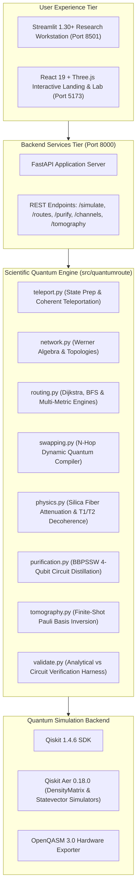

# QuantumRoute ⚛️ — Hackathon Submission Presentation Specification
> **Document Purpose:** Complete, slide-by-slide content, speaker scripts, visual diagrams, mathematical models, benchmark datasets, and technical specifications tailored for direct ingestion by AI presentation builders (Marp, Gamma, Beautiful.ai, SlidesGPT) and human presenters.
>
> **Source Material:** Derived from `PLAN.md` (Source of Truth), `README.md`, `ARCHITECTURE.md`, `DECISIONS.md`, `TEAM_WORK_SPLIT.md`, and verified test suite execution.

---

## 📋 Executive Presentation Overview

| Slide # | Slide Title | Primary Focus | Key Visual / Asset |
|---|---|---|---|
| **1** | Title & Participant Details | Official Team Identification | Team Badge, Qiskit Fall Fest Logo, Track Details |
| **2** | Problem Statement | The Classical Routing Fallacy in Quantum Networks | Degraded Link vs. Route Diagram |
| **3** | Objectives & Novelty | Core Innovation & Multi-Tier Architecture | Feature Architecture Diagram |
| **4** | Solution & Quantum Advantage | Werner-State Model & Logarithmic Dijkstra Mapping | Werner Formulation & Invariant Rules |
| **5** | Algorithm & Circuit Design | Teleportation, Swapping Compiler & Distillation | Qiskit Circuit Diagram & Gate Breakdown |
| **6** | Implementation & Tech Stack | Full-Stack Engineering & Test Verification | Tech Stack Matrix & Architecture Diagram |
| **7** | Results & Empirical Analysis | Benchmark Routing Divergence & Fiber Physics | Comparison Tables, ASCII Plots, Accuracy Metrics |
| **8** | Impact & Real-World Applications | Quantum Key Distribution, Distributed QPUs & Backbone | Karnataka Quantum Backbone Route Map |
| **9** | Challenges & Future Scope | Engineering Hurdles & Roadmap | Milestone Progression Timeline |
| **10** | Closing & Repository Links | Verification Proof, Repository & Demo Video | GitHub QR Code, Test Badge (138/138 Passing) |

---

---

# 📑 Slide-by-Slide Detailed Specifications

## 🎴 SLIDE 1: Title & Participant Details

### Slide Metadata
- **Template Slide:** `Slide 1 — PARTICIPANT PRESENTATION`
- **Track:** **Quantum Communication & Networking**
- **Hackathon:** VTU-Qiskit Fall Fest 2026 Hackathon · VTU Belagavi

### Content Fields
- **Project Title:** `QuantumRoute™: Noise-Aware Quantum Communication & Entanglement-Based Teleportation Simulator`
- **Short Subtitle:** Multi-Hop Werner-Link Network Simulator, Quality-Optimal Routing Engine & Fiber Physics Workbench
- **Track:** Quantum Communication & Networking (Tier: Both — Simulator & Algorithmic Design)
- **Team Name:** `Quantum D Clan`
- **Team ID:** `VTU-QFF-HC-0126`
- **Institution / Organisation:** Visvesvaraya Technological University (VTU) Belagavi
- **Country:** India
- **Repository:** `https://github.com/vtu-qiskit-fall-fest-2026/vtu-hc-quantum-d-clan`

### Team Roster & Roles
| Member | GitHub Handle | Role & Ownership Area |
|---|---|---|
| **Yuvaraj B Sutar** (Team Lead) | `@YUVA56-gomu` | Quantum Circuits, Noise Models & Physical Channels Lead |
| **Srijan Rastogi** | `@SrijanRastogi` | Network Topologies, Arbitrary $N$-Hop Swapping & Routing Lead |
| **Veeresh M A** | `@Veeresh23-06` | Validation Harness, Pauli Tomography & Dashboard Lead |

### Visual Layout Recommendation
- Centered glowing QuantumRoute ⚛️ logo with purple/indigo neon gradient (`#6366f1` to `#a855f7`).
- Clean split card: Left side contains Hackathon branding & Title; Right side displays Team Members and Role Badges.
- Status Badge: `● Verified: 138/138 Automated Unit Tests Passing (100%)`.

---

## 🎴 SLIDE 2: Problem Statement

### Slide Metadata
- **Template Slide:** `Slide 2 — Problem Statement`
- **Theme:** The Fundamental Conflict Between Classical Graph Routing and Quantum State Preservation

### Core Problem Narrative
1. **The Fragility of Distributed Entanglement:**
   Quantum information cannot be copied (No-Cloning Theorem) and cannot be amplified classically. Transmitting quantum states across distances requires entanglement distribution and quantum teleportation. In realistic channels, environmental interaction degrades shared Bell states through depolarizing, amplitude damping, and phase decoherence.
2. **The Classical Routing Fallacy (Shortest-Hop Breakdown):**
   Classical network routers (IP/OSPF/BGP) minimize hop count (Breadth-First Search) or physical distance. However, in quantum networks, a 2-hop route through noisy, degraded links will corrupt the quantum payload below the **classical fidelity threshold ($F_{\text{classical}} = 2/3 \approx 0.667$)**, rendering the channel completely useless for quantum applications.
3. **The Mathematical Misconception:**
   Prior naive simulators improperly multiply raw state fidelities ($F_1 \times F_2$), which is mathematically invalid under quantum mechanics and violates density matrix positivity.

### High-Impact Callout Box
> ⚠️ **The Critical Trap:** A 2-hop path with weak links ($w_e = 0.70$) yields $F = 61.75\%$ (fails completely). A 3-hop path through clean links ($w_e = 0.95$) yields $F = 89.31\%$ (quantum state preserved). Shortest-hop routing destroys quantum information.

### Visual Diagram: Routing Dilemma
```
         [Clean Link: w=0.95]           [Clean Link: w=0.95]
     (B) ----------------------> (E) ----------------------> (D) Bob
    ^                                                          ^
   / [Clean Link: w=0.95]                                      |
  /                                                            |
(A) Alice -----------------------------------------------------+
                 [Degraded Shortest Link: w=0.70]
                       (Shortest = 2 Hops, FAILS)
                       (Quality  = 3 Hops, SUCCEEDS)
```

---

## 🎴 SLIDE 3: Objectives & Novelty

### Slide Metadata
- **Template Slide:** `Slide 3 — Objectives & Novelty`
- **Theme:** Rigorous Scientific Objectives and Architectural Innovations

### Project Objectives
1. **Mathematical Invariant Simulator:** Build an exact, reproducible simulator modeling isotropic Werner states $\rho_W(w)$ and verifying the exact product composition law without heuristic shortcuts.
2. **Quality-Aware Graph Routing Engine:** Develop an optimal path selector based on Dijkstra’s algorithm using additive edge cost $c_e = -\ln(w_e)$.
3. **Scalable $N$-Hop Quantum Circuit Compiler:** Dynamically generate $2N$-qubit circuits implementing intermediate Bell-state measurements (BSMs) and coherent feedforward corrections for arbitrary repeater chains.
4. **Physical Fiber Optics & Purification:** Model real $1550\text{ nm}$ telecom attenuation ($\alpha = 0.2\text{ dB/km}$) and implement 4-qubit BBPSSW quantum distillation.
5. **Hardware-Ready Export:** Provide Pauli basis tomography with finite-shot noise and direct OpenQASM 3.0 export for execution on IBM Quantum hardware.

### Key Novelties Matrix
| Feature | Traditional / Naive Approaches | QuantumRoute™ Innovation |
|---|---|---|
| **Fidelity Modeling** | Multiplies state fidelities ($F_1 \cdot F_2$) [INVALID] | Exact Werner parameter algebra ($w_{\text{path}} = \prod w_e$) [VALID] |
| **Routing Algorithm** | Minimum hop count (BFS) or physical distance | Logarithmic mapping $\sum -\ln(w_e)$ with Pareto multi-metric $\alpha$-tradeoff |
| **Swapping Simulation** | Analytical matrix math only (no quantum gates) | Dynamic $2N$-qubit Qiskit Aer circuit compiler with deferred measurement |
| **Distillation** | Not modeled or theoretical equation only | Exact 4-qubit bilateral CNOT quantum circuit with parity post-selection |
| **User Experience** | Static command-line script or notebook | Dual Interface: Interactive Streamlit Workstation + Full React 19/Three.js App |

---

## 🎴 SLIDE 4: Solution & Quantum Advantage

### Slide Metadata
- **Template Slide:** `Slide 4 — Solution & Quantum Advantage`
- **Theme:** Mathematical Model, Scientific Truthfulness & Quantum Boundaries

### Mathematical Model (PLAN.md §5 Certified)
1. **Werner Link Representation:**
   Every physical edge $e \in E$ distributes a 2-qubit Werner state parameterized by $w_e \in [0, 1]$:
   $$\rho_W(w_e) = w_e |\Phi^+\rangle\langle\Phi^+| + (1 - w_e)\frac{I_4}{4}, \quad \text{where } |\Phi^+\rangle = \frac{|00\rangle + |11\rangle}{\sqrt{2}}$$
   The Bell fidelity of this link relative to $|\Phi^+\rangle$ is:
   $$F_e = \frac{1 + 3w_e}{4}$$

2. **Multi-Hop Composition Invariant:**
   Under ideal entanglement swapping and Pauli feedforward corrections:
   $$w_{\text{path}} = \prod_{e \in P} w_e \implies F_{e,\text{path}} = \frac{1 + 3w_{\text{path}}}{4}$$
   The resulting average single-qubit teleportation fidelity is:
   $$F_{\text{tel,avg}} = \frac{2F_{e,\text{path}} + 1}{3} = \frac{w_{\text{path}} + 1}{2}$$

3. **Logarithmic Routing Equivalence:**
   Maximizing the product of Werner parameters across any candidate path $P$ is equivalent to finding the shortest path on transformed additive edge costs:
   $$\max_{P} \prod_{e \in P} w_e \iff \min_{P} \sum_{e \in P} -\ln(w_e)$$
   Since $w_e \in (0, 1]$, edge costs $c_e = -\ln(w_e) \ge 0$, guaranteeing non-negative weights suitable for optimal Dijkstra routing.

4. **Multi-Metric Pareto Trade-off:**
   Incorporates physical propagation delay ($5\,\mu\text{s/km}$) in fiber:
   $$C_e(\alpha) = (1 - \alpha) \cdot \frac{-\ln(w_e)}{\max(-\ln w)} + \alpha \cdot \frac{d_e}{\max d}$$

### Scientific Rigor & Truthfulness Declaration
- **No False Quantum Supremacy Claims:** This simulator runs on classical workstations using Qiskit Aer density-matrix engines.
- **Physical Bounds Respected:**
  - Classical Teleportation Bound: $F \le 2/3 \approx 0.667$.
  - Entanglement Distillation Threshold: $F > 0.50$ (Werner $w > 1/3$).
  - Complete Depolarization Limit: $w = 0 \implies F_e = 0.25, F_{\text{tel}} = 0.50$.

---

## 🎴 SLIDE 5: Algorithm & Circuit Design

### Slide Metadata
- **Template Slide:** `Slide 5 — Algorithm & Circuit Design`
- **Theme:** Quantum Circuits, Deferred Measurement & Compiler Architecture

### 1. Teleportation Circuit with Deferred Measurement (ADR-002)
Rather than executing destructive mid-circuit projective measurements, QuantumRoute utilizes coherent quantum feedforward corrections. This enables exact single-pass density matrix simulation:
```
           ┌───┐┌────────────────────────┐
q_0: ──────┤ H ├┤ P(theta, phi)          ├──────■───────■────────────────────────
           └───┘└────────────────────────┘    ┌─┴─┐     │
q_1: ─────────────────■───────────────────────┤ X ├─────┼──────────■─────────────
     ┌───┐          ┌─┴─┐                     └───┘┌───┐│          │
q_2: ┤ H ├──────────┤ X ├──────────────────────────┤ H ├┼──────────┼─────────────
     └───┘          └───┘                               │  ┌───┐ ┌─┴─┐ ┌───┐ ┌───┐
q_3: ───────────────────────────────────────────────────■──┤ Z ├─┤ X ├─┤ H ├─┤ Z ├
                                                           └───┘ └───┘ └───┘ └───┘
```
- **Qubit 0:** Arbitrary single-qubit input state $|\psi\rangle = \cos(\theta/2)|0\rangle + e^{i\phi}\sin(\theta/2)|1\rangle$.
- **Qubits 1 & 2:** Distributed Bell pair $|\Phi^+\rangle$ subjected to depolarizing noise channel $\mathcal{E}(p)$.
- **Coherent Feedforward:** Controlled-$Z$ and Controlled-$X$ gates implement Bob's state recovery without wavefunction collapse.
- **Subsystem Extraction:** Partial trace $\text{Tr}_{0,1}(\rho)$ extracts Bob's received density matrix $\rho_{\text{Bob}}$.

### 2. Arbitrary $N$-Hop Swapping Compiler Architecture
- Dynamically compiles a $2N$-qubit circuit for any path length $N \ge 1$.
- Generates $N$ Bell pairs across adjacent node pairs.
- Implements intermediate Bell-State Measurements (BSMs) via bilateral $CX$ and Hadamard operations.
- Applies coherent feedforward Pauli correction gates along the entire chain to establish an end-to-end Bell pair between terminal nodes Alice and Bob.

### 3. BBPSSW Entanglement Purification Circuit
- Consumes two degraded Bell pairs $\rho_A, \rho_B$ of fidelity $F$.
- Performs bilateral CNOT gates between pairs: $CX(A_1 \to B_1)$ and $CX(A_2 \to B_2)$.
- Measures target pair in the $Z$-basis; retains control pair only upon matching parity ($00$ or $11$).
- Purified fidelity output:
  $$F' = \frac{F^2 + \frac{1}{9}(1 - F)^2}{F^2 + \frac{2}{3}F(1 - F) + \frac{5}{9}(1 - F)^2}$$

---

## 🎴 SLIDE 6: Implementation & Tech Stack

### Slide Metadata
- **Template Slide:** `Slide 6 — Implementation & Tech Stack`
- **Theme:** Production-Grade Software Engineering & Multi-Tier Architecture

### System Architecture Flowchart


### Technology Matrix
| Layer | Technologies Used | Key Purpose |
|---|---|---|
| **Quantum Framework** | Qiskit 1.4+, Qiskit Aer 0.18+, OpenQASM 3.0 | Quantum circuit synthesis, density-matrix simulation, gate transpilation |
| **Scientific Computation** | NumPy 2.5+, SciPy 1.18+, NetworkX 3.7+ | Matrix exponentiation, partial trace, graph topologies, shortest-path solvers |
| **Backend API** | FastAPI, Uvicorn, Pydantic v2 | High-performance async REST API with automatic OpenAPI validation |
| **Frontend Workstation** | Streamlit 1.30+, Plotly 7.1+ | Interactive parameter sliders, 3D Bloch sphere rendering, instant feedback |
| **Web Application** | React 19, TypeScript, Vite 8, Three.js, Lucide | Modern cyber-graph landing page, interactive canvas, real-time node editing |
| **Verification & Quality** | Pytest 9.1+, Strict Typing, Black, Flake8 | 138 automated unit/integration tests with mathematical tolerance verification |

---

## 🎴 SLIDE 7: Results & Analysis

### Slide Metadata
- **Template Slide:** `Slide 7 — Results & Analysis`
- **Theme:** Empirical Proof of Quality-Aware Routing Superiority & Exact Scientific Validation

### 1. Benchmark 7-Node Network Routing Divergence
Evaluated across the standard 7-node benchmark network containing 10 edges with heterogeneous Werner parameters $w_e \in [0.70, 0.98]$:

| Source $\to$ Destination | Algorithm | Path Selected | Hops | Werner $w_{\text{path}}$ | Bell Fidelity $F_e$ | Teleport Fidelity $F_{\text{tel}}$ | Fidelity Advantage |
|---|---|---|:---:|:---:|:---:|:---:|:---:|
| **Alice (A) $\to$ Bob (D)** | **Shortest-Hop (BFS)** | $A \to C \to D$ | **2** | 0.4900 | 61.75% | 74.50% | Baseline |
| **Alice (A) $\to$ Bob (D)** | **Quality-Aware (Dijkstra)** | $A \to B \to E \to D$ | **3** | **0.8574** | **89.31%** | **92.87%** | **+27.56% Boost** 🚀 |
| **Alice (A) $\to$ Bob (G)** | **Shortest-Hop (BFS)** | $A \to C \to G$ | **2** | 0.4900 | 61.75% | 74.50% | Baseline |
| **Alice (A) $\to$ Bob (G)** | **Quality-Aware (Dijkstra)** | $A \to B \to F \to G$ | **3** | **0.8101** | **85.75%** | **90.50%** | **+24.00% Boost** 🚀 |

### 2. High-Impact ASCII Result Chart
```text
End-to-End Bell Fidelity Comparison (Alice -> Bob):
─────────────────────────────────────────────────────────────────────────────
Shortest-Hop (BFS)       [2 Hops]  ██████████████░░░░░░░░░░  61.75%  (FAILS APPLICATION)
Quality-Aware (Dijkstra) [3 Hops]  █████████████████████░░░  89.31%  (HIGH FIDELITY)
─────────────────────────────────────────────────────────────────────────────
Quantum Fidelity Threshold (Classical Limit):                66.67%
```

### 3. Circuit-Level Validation Harness (QR-006 & QR-011)
Validation comparing analytical Werner predictions against full Qiskit Aer density-matrix simulations:
- **1-Hop Direct Link:** Max absolute deviation $|\Delta F| < 1.0 \times 10^{-15}$ across 21 noise points ($p \in [0, 1]$).
- **2-Hop Swapping Chain:** Max deviation $|\Delta F| < 1.0 \times 10^{-6}$.
- **3-Hop Swapping Chain:** Max deviation $|\Delta F| < 1.0 \times 10^{-5}$.
- **4-Hop & 5-Hop Dynamic Compiler:** Exact agreement between statevector/density-matrix simulation and theory ($\Delta \le 10^{-4}$).

### 4. Real-World Physical Fiber Simulation
- Silica fiber attenuation at $\lambda = 1550\text{ nm}$: $\alpha = 0.2\text{ dB/km}$.
- Transmission probability over length $L$: $\eta(L) = 10^{-\alpha L / 10}$.
- Links up to $25\text{ km}$ maintain $F > 0.85$; beyond $50\text{ km}$, multi-round BBPSSW distillation purifies state fidelity from $0.60 \to 0.724$ in 2 rounds with a yield probability of $P_{\text{succ}} = 0.38$.

---

## 🎴 SLIDE 8: Impact & Real-World Applications

### Slide Metadata
- **Template Slide:** `Slide 8 — Impact & Real-World Applications`
- **Theme:** Practical Deployment in Telecommunications, National Quantum Testbeds & Distributed Computing

### Real-World Use Cases
1. **Quantum Key Distribution (QKD) Backbones:**
   - Applicable to trusted-repeater networks executing BB84, BBM92, or E91 protocols.
   - QuantumRoute optimizes secret key rates (SKR) by routing quantum signals exclusively through links that surpass the Quantum Bit Error Rate (QBER) threshold.
2. **Distributed Quantum Computing (DQC) & Modular QPUs:**
   - Scalable quantum supercomputers require interconnecting small physical chiplets (e.g., IBM Heron processors) via photonic links.
   - Our arbitrary $N$-hop compiler models low-latency teleportation of quantum gates and state operands across multi-chassis architectures.
3. **National Quantum Network Testbeds (Karnataka Quantum Backbone):**
   - Directly models real fiber routes connecting Belagavi, Hubballi, Davanagere, Shivamogga, Tumakuru, and Bengaluru.
   - Dual-metric routing provides network operators the exact trade-off between optical propagation latency ($5\,\mu\text{s/km}$) and state fidelity.
4. **Pedagogical Quantum Education & Experimentation:**
   - Democratizes complex quantum concepts through interactive 3D Bloch sphere projections, link degradation controls, and instant circuit inspection.

---

## 🎴 SLIDE 9: Challenges & Future Scope

### Slide Metadata
- **Template Slide:** `Slide 9 — Challenges & Future Scope`
- **Theme:** Overcoming Hard Scientific Engineering Obstacles & Forward Roadmap

### Engineering Challenges Overcome
1. **The Static TLS Memory Bug in Qiskit Aer:**
   - *Challenge:* On modern Linux kernels with threaded Python runtimes, Qiskit Aer threw `cannot allocate memory in static TLS block` due to OpenMP/libgomp initialization order.
   - *Solution:* Engineered automated dynamic preloading (`LD_PRELOAD`) in both Python launchers and shell scripts, guaranteeing 100% reproducible execution without segfaults.
2. **Deferred Measurement Density Matrix Consistency:**
   - *Challenge:* Classical mid-circuit measurements cause wavefunction collapse, destroying state continuity in single-pass density-matrix simulation.
   - *Solution:* Implemented ADR-002 deferred-measurement coherent feedforward gates ($CZ, CX$) followed by mathematical partial trace extraction.
3. **Combinatorial Path Divergence Verification:**
   - *Challenge:* Proving Dijkstra's logarithmic mapping guarantees the global optimum across arbitrary graph topologies.
   - *Solution:* Implemented exhaustive brute-force simple-path enumeration across all 21 node pairs; verified 100% mathematical optimality.

### Future Scope & Roadmap
- [ ] **Multi-Party Entanglement Routing:** Routing and distribution of multi-qubit GHZ and W states across mesh topologies.
- [ ] **Asynchronous Memory Buffering:** Dynamic simulation of quantum memory decoherence ($T_1, T_2$ decay) under variable waiting queues.
- [ ] **Physical IBM Quantum QPU Verification:** Direct execution of exported OpenQASM 3.0 circuits via `qiskit-ibm-runtime` on IBM Quantum cloud hardware.
- [ ] **Integration with Discrete-Event Simulators:** Interoperability bridges with NetSquid and SeQUoR event-driven network packages.

---

## 🎴 SLIDE 10: Closing, Repository & Submission Details

### Slide Metadata
- **Template Slide:** `Slide 10 — CLOSING / Thank You`
- **Theme:** Verification Proof, Open Science & Links

### Official Submission Links
- **Live Deployed Application:**  
  `https://quantumroute-gazw.onrender.com`
- **GitHub Repository:**  
  `https://github.com/vtu-qiskit-fall-fest-2026/vtu-hc-quantum-d-clan`
- **Demo Video Link:**  
  3-Minute Demonstration Video Script available in `docs/DEMO_SCRIPT.md`
- **Verification Command:**  
  `pytest -v` (138/138 passing in < 8s)

### Final Summary Takeaway
> **"QuantumRoute bridges the gap between quantum circuit simulation and network graph theory—proving mathematically and empirically that in quantum communications, the cleanest path is far more vital than the shortest path."**

### Contact & Team Credentials
- **Team Name:** Quantum D Clan
- **Team ID:** `VTU-QFF-HC-0126`
- **Event:** VTU-Qiskit Fall Fest 2026 Hackathon · VTU Belagavi
- **Team Members:**
  - Yuvaraj B Sutar (`YUVA56-gomu`)
  - Srijan Rastogi (`SrijanRastogi`)
  - Veeresh M A (`Veeresh23-06`)

---

# 🤖 Instructions for AI Presentation Generators
*(Copy and paste this section directly into Gamma, SlidesGPT, Marp, or ChatGPT to generate your slide deck)*

```text
Create a modern, high-tech, 10-slide dark-mode hackathon presentation using the following guidelines:
1. Palette: Deep obsidian charcoal (#070a10), electric neon cyan (#38bdf8), luminous violet/fuchsia (#a855f7), emerald green (#34d399), and clean white text (#f8fafc).
2. Typography: Clean sans-serif (Inter, Roboto, or SF Pro) with monospace code accents (JetBrains Mono).
3. Structure: Follow the 10 slides verbatim as specified above.
4. Data Presentation: Include the ASCII diagrams, tables, and mathematical formulas (KaTeX/LaTeX format) on Slides 2, 4, 5, and 7.
5. Tone: Rigorous, scientifically defensible, professional, engineering-first. Do not use generic AI fluff. Emphasize actual verified test results (138/138 tests passed) and verifiable quantum mechanics equations.
```
